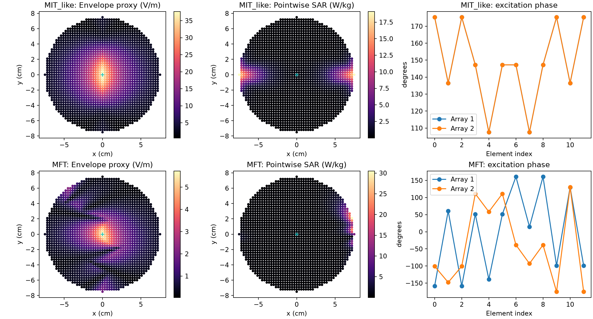
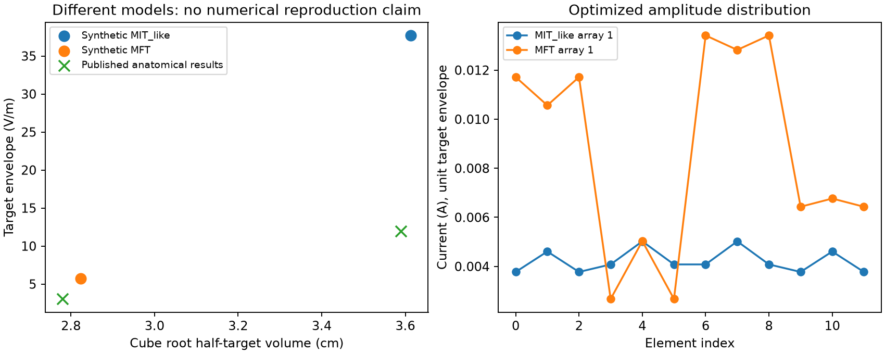
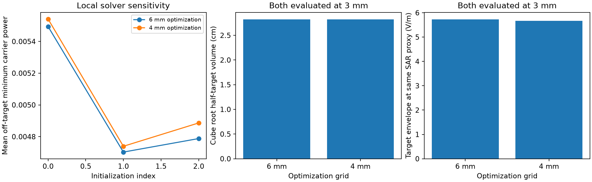

# RF forward model and optimization reconstruction

This implementation reconstructs the **method**, not the numerical result of the anatomical EMvelop study. It does not use the original segmented head, antenna mesh, tissue table, solver state or optimized currents. Its material constants and spherical observation region are explicit assumptions; no parameter is fitted to 11.98 V/m or 3.59 cm.

## Forward problem implemented

Peak phasors use $e^{i\omega t}$. The medium is infinite, homogeneous and isotropic. The observation sphere is not an electromagnetic interface.

$$
\nabla\times\nabla\times\mathbf E-k^2\mathbf E
=-i\omega\mu_0\mathbf J,
\qquad k^2=\omega^2\mu_0\epsilon_0\epsilon_r-i\omega\mu_0\sigma.
$$

The outgoing, attenuating branch has $\operatorname{Re}k>0$ and $\operatorname{Im}k<0$. For $R=\lVert\mathbf r-\mathbf r'\rVert$,

$$
g(R)=\frac{e^{-ikR}}{4\pi R},\qquad
\mathbf E(\mathbf r)=-i\omega\mu_0\int
\left(\mathbf I+\frac{\nabla\nabla}{k^2}\right)g(R)\,
\mathbf J(\mathbf r')\,dV'.
$$

For a straight line along $z$, the unit-current transfer is computed by eight-point Gauss–Legendre quadrature along its 1 cm length. With $\widehat{\mathbf R}=(\mathbf r-\mathbf r')/R$, the dyadic integrand is

$$
\left(\mathbf I+\frac{\nabla\nabla}{k^2}\right)g
=g\left[a\mathbf I+b\widehat{\mathbf R}\widehat{\mathbf R}^{T}\right],
\quad a=1-\frac{i}{kR}-\frac{1}{(kR)^2},\quad
b=-1+\frac{3i}{kR}+\frac{3}{(kR)^2}.
$$

This retains induction, electrostatic near-field and radiative terms. It is a full-wave Green-function solution in a homogeneous medium, not a heterogeneous FEM solution. Finite current segments imply endpoint charge through continuity. Mutual antenna impedance and feed structure are absent: the currents are prescribed ideal sources.

| Parameter | Implemented assumption |
|---|---|
| Carrier | 1.5 GHz; 100 Hz offset neglected in transfer matrix only |
| Relative permittivity / conductivity | 50 / 1 S/m |
| Density | 1000 kg/m³ |
| Observation sphere radius | 7.5 cm |
| Arrays | planes x=±8.5 cm; 4×3 elements each |
| Array span | y=4.2 cm, z=4.7 cm |
| Line element | 1 cm, oriented along z |
| Target | origin; each array supplies 0.5 V/m along z |

## Optimization actually solved

Let $G_{i,n}\in\mathbb C^{3\times12}$ be a unit-current transfer matrix, and $w_i\in\mathbb C^{12}$ be excitation currents. Then

$$
\mathbf E_{i,n}=G_{i,n}w_i,\qquad
M_n=2\min(\lVert\mathbf E_{1,n}\rVert_2,\lVert\mathbf E_{2,n}\rVert_2).
$$

$M_n$ follows the orientation-free vector-norm envelope proxy used for this reconstruction. For arbitrary differently polarized fields it is **not** the modulation of a fixed neuron-axis projection, nor necessarily the excursion of the instantaneous vector magnitude.

The **MIT-like baseline** solves a well-defined minimum-current problem, rather than asserting that the paper's underdetermined target-fitting objective selects unique currents:

$$
\min_{w_i}\lVert w_i\rVert_2^2
\quad\text{subject to}\quad G_{i,T}w_i=\mathbf b,
\qquad \mathbf b=(0,0,0.5)^T\ \mathrm{V/m}.
$$

Its solution is the pseudoinverse $w_i^{(0)}=G_{i,T}^{\dagger}\mathbf b$. This baseline maximizes neither the thermally scaled target field nor every possible intensity objective.

The **MFT reconstruction** minimizes the actual min-of-carrier-powers objective, rather than replacing it by the sum of the individual carrier powers:

$$
\min_{w_1,w_2}\frac{1}{N_{\mathrm{off}}}
\sum_{n\ne T}\min\left(\lVert G_{1,n}w_1\rVert_2^2,
\lVert G_{2,n}w_2\rVert_2^2\right),
\quad\text{subject to }G_{1,T}w_1=G_{2,T}w_2=\mathbf b.
$$

This target-vector constraint is **stricter** than a target-norm equality: it fixes polarization and phase. The objective is nonconvex and nonsmooth; the code reports local solver outcomes and does not claim a global optimum.

With $Z_i$ an orthonormal nullspace basis of $G_{i,T}$, parameterize

$$
w_i=w_i^{(0)}+Z_i v_i.
$$

The constraints then hold to numerical precision throughout optimization. Real and imaginary parts of $v_i$ are optimized by L-BFGS-B, with analytic derivatives of the locally active carrier power, three deterministic starts and up to 400 iterations. Ties select the first carrier's derivative. The code exports success flags, termination messages, gradient norms, iteration counts, objective values and target residuals. Current amplitudes are unbounded; large-current or poorly conditioned solutions are not hardware designs.

## Focality and heating

The primary 3D metric is **cube root of total suprathreshold volume**, including disconnected off-target regions:

$$
L_{50}=\left[\sum_n\Delta V\,
\mathbf 1\{M_n\ge M_T/2\}\right]^{1/3}.
$$

This is distinct from the equivalent sphere diameter used in the first TMS feasibility report. Relative focality is invariant under common amplitude scaling.

After averaging complete beat periods,

$$
\mathrm{SAR}_n=\frac{\sigma}{2\rho}
\left(\lVert\mathbf E_{1,n}\rVert_2^2+
\lVert\mathbf E_{2,n}\rVert_2^2\right).
$$

The runner reports both a pointwise 2 W/kg scaling and an approximate cube-average 10 W/kg scaling. The latter chooses the nearest voxel cube to 10 g and normalizes by occupied volume at boundaries. Actual full-cube mass is exported; boundary cubes contain less material. This is **not exact regulatory 10-g averaging**, and none of these scales certifies safety. The RF module itself does not solve temperature. Field arrays are exported for a separate shared thermal calculation.

## Code and numerical verification

| Mathematical operation | Implementation |
|---|---|
| Dyadic Green integral | `src/emvelop_rf.py:transfer` |
| Target pseudoinverse and nullspace | `basis` |
| Nonconvex objective and analytic derivatives | `optimize` |
| Cube-root volume and SAR scaling | `evaluate` |
| Experiment and figures | `scripts/run_emvelop_rf.py` |

Tests check eight-versus-sixteen-point quadrature, dipole equatorial symmetry, target/nullspace residuals, and finite differences of the complex optimization gradient. Optimization uses a 6 mm grid, and fixed optimized currents are reevaluated on 6, 4 and 3 mm grids. This checks evaluation discretization, not convergence of the optimized currents with respect to training-grid refinement.





The published comparison points in the figure come from [Fatima Ahsan's research page](https://fatimaahsan.rice.edu/projects/): intensity-focused 11.98 V/m and 3.59 cm; focality-focused 3.04 V/m and 2.78 cm. They are contextual markers from a different anatomical forward model, not validation targets attained by tuning this model.

Run from the repository root:

```bash
OPENBLAS_NUM_THREADS=1 micromamba run -n tms312 python scripts/run_emvelop_rf.py
micromamba run -n tms312 python -m pytest tests/test_emvelop_rf.py -q
```

Artifacts: `analysis/emvelop/rf_results.json`, `rf_fields.npz`, `rf_fields.png`, and `rf_tradeoff.png`. NPZ fields have unit target envelope before SAR scaling and include coordinates, mask and grid spacing.

## Executed results

| 3 mm evaluation | MIT-like | MFT |
|---|---:|---:|
| Cube-root half-target volume | 3.613 cm | 2.824 cm |
| Half-target volume | 47.169 cm³ | 22.518 cm³ |
| Target at pointwise 2 W/kg proxy | 12.194 V/m | 1.467 V/m |
| Target at approximate cube-average 10 W/kg | 37.701 V/m | 5.729 V/m |

The finest cube contains 9.261 g when completely occupied. Its boundary truncation and discretization differ from the original 10-g procedure. The apparent focality agreement with the published values is not sufficient for a reproduction claim: the intensities do not match, tissue properties and anatomy differ, and the optimization target constraints differ.

All three local runs reported convergence, at objective values 0.0054941, 0.0047028 and 0.0047880. The second start was selected. The different terminal values demonstrate local-solution sensitivity. From 4 to 3 mm, the cube-root volume changes by about 0.18% for MIT-like and 1.49% for MFT. Approximate averaged-SAR target scaling changes by 0.32% and 2.89%, respectively; its averaging cube mass also changes with resolution, so this is not purely EM grid convergence. Two focused tests passed. Figures were opened and inspected.

## Independent physics and optimization refinement checks

Two additional tests independently check the lossless transverse far-field amplitude/phase and a finite-difference source-free Maxwell residual. The latter verifies $\nabla\times\nabla\times\mathbf E-k^2\mathbf E$ relative to $k^2\mathbf E$ below $10^{-4}$ away from sources. **Four RF tests pass.**

`check_emvelop_rf_refinement.py` repeats all three starts on a 4 mm optimization grid, then evaluates the selected solution at the same 3 mm observation points as the main run. It leaves the main currents and field NPZ untouched.

| Optimization grid; common 3 mm evaluation | 6 mm | 4 mm |
|---|---:|---:|
| MFT cube-root half-target volume | 2.82386 cm | 2.82273 cm |
| Target at identical approximate cube-average SAR ceiling | 5.72866 V/m | 5.67215 V/m |

Focality changes 0.040%; thermally scaled amplitude changes 0.99%. This supports stability of the selected local solution to this refinement. It does not establish global convergence: different initializations still reach distinct objectives (approximately 0.00554, 0.00474 and 0.00489 on the 4 mm grid). The objective is sampled on different grids, so their values should not be treated as identical quadrature evaluations.



```bash
OPENBLAS_NUM_THREADS=1 micromamba run -n tms312 python scripts/check_emvelop_rf_refinement.py
```
