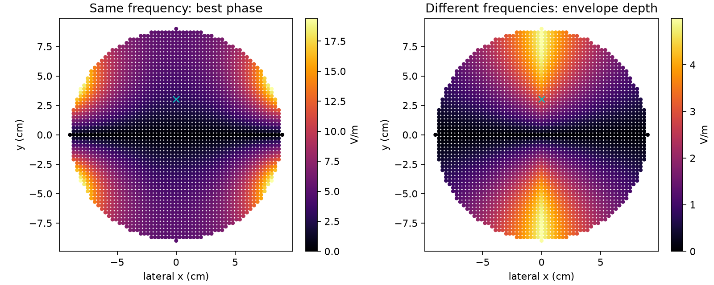

# EMvelop and bilateral TMS feasibility

Date: 2026-11-12. Scope: public literature review and synthetic physics calculation; no subject data.

## Identification and forward modelling

The work is **EMvelop stimulation: minimally invasive deep brain stimulation using temporally interfering electromagnetic waves**, Fatima Ahsan, Taiyun Chi, Raymond Cho, Sameer A. Sheth, Wayne Goodman and Behnaam Aazhang, *Journal of Neural Engineering* 19 (2022), 046005, [DOI](https://doi.org/10.1088/1741-2552/ac7894), [abstract](https://pubmed.ncbi.nlm.nih.gov/35700717/). Its representative computational result is a **12 V/m envelope and 3.6 cm focality**, using two **4.2 × 4.7 cm endocranial arrays**. These are implanted arrays, not external TMS coils. This is a proof of principle, not demonstration of equivalent neuronal recruitment by GHz fields and TMS.

The authors' [technical patent disclosure](https://patents.google.com/patent/US12478788B2/en) supplies the following methodological detail (distinguished from independent reproduction of the journal article):

- MRI-derived, eleven-tissue anatomy; tissue-dependent electromagnetic and thermal properties.
- Frequency-domain FEM of line-current antennas; absorbing outer EM boundaries.
- Per-element complex field responses assembled into a linear transfer matrix; complex currents control amplitude and phase.
- Two carriers, illustrated at 1.5 GHz and 1.5 GHz + 100 Hz.
- Maximum-intensity transmission balances the target contributions from the two arrays. Maximum-focality transmission minimizes off-target field power while constraining target contributions. Excitations are scaled to satisfy thermal limits.
- One-way EM-to-bioheat coupling includes perfusion, with insulating thermal boundaries. Examples constrain temperature rise below 1 °C and inspect 10-g averaged SAR.
- The 2D focality measure is square root of area above half the target envelope; it is not necessarily FWHM diameter. Three-dimensional values must not be compared to this area metric without checking their definition.

The thesis was located but could not be downloaded in this session. The detailed account above is attributed to the authors' accessible disclosure; the journal abstract independently verifies the headline result.

## What the phase variables do

The following equations explain the mechanism independently. With peak phasors and a consistent exp(iωt) convention, a frequency-domain forward model has the form

`curl(mu^-1 curl E) - (omega² epsilon - i omega sigma) E = -i omega J`.

If `G_i(r,m)` is the complex unit-current response of antenna m, then `E_i(r) = sum_m G_i(r,m) w_i,m`. For a scalar target projection and a fixed excitation norm, phase conjugation `w_m ∝ conj(G(target,m))` aligns contributions at the target. This is a useful baseline, not a claim that unconstrained conjugation solves the authors' full thermal optimization. Penalizing off-target energy replaces this with a constrained quadratic problem involving the transfer matrix outside the target. Full-wave propagation supplies spatially varying complex phases across centimetres.

For two scalar carriers of amplitudes a and b, envelope excursion is `2 min(a,b)`. Their initial relative phase translates the beat in time; it does not change that excursion. Vector fields require an orientation-specific or vector-envelope definition. The heating is set by the carriers, not by squaring the envelope: averaged over beat cycles, `SAR = (sigma1 |E1|² + sigma2 |E2|²)/(2 rho)`.

A linear membrane low-pass filter cannot manufacture a difference-frequency electrical component from two GHz sinusoids. Biological demodulation requires a nonlinear mechanism. Consequently, 12 V/m of GHz envelope is not an established equivalent to 12 V/m of directly applied low-frequency field.

## Bilateral coil model and design implications

For a closed thin loop in vacuum, the primary induction field is

`E(r,t) = -mu0/(4 pi) integral_loop dl/|r-r'| × dI/dt`,

where × here denotes scalar multiplication, not a cross product. The code evaluates the vector line integral directly. Two coils provide only two spatial basis fields. At the same carrier frequency their complex weights can interfere; at distinct frequencies relative phase alone cannot reshape the full-beat envelope. Quasistatic fields do not acquire the useful propagation delays of GHz array beamforming.

Opposed coaxial circular loops have an exact induction-field null along their common axis, including the brain centre. No choice of their currents or phases removes that null in this model. Off-axis stimulation is possible but rotational symmetry produces ring-like exposure rather than a unique deep spot. Coil tilt, displacement, figure-eight windings or additional independently controlled coils would change the design space and require a new optimization.

The implementation and generated numerical results below test these statements without introducing artificial tissue boundaries. Conductivity is applied only afterwards as a heating proxy: vacuum itself does not absorb heat. Secondary electric fields, heterogeneous conductivity, coil losses and thermal transport are outside the field solution.

## Heat comparison: what can and cannot be matched

Typical TMS fields are of order **100 V/m**, with submillisecond pulses ([primary experimental paper](https://pmc.ncbi.nlm.nih.gov/articles/PMC6866442/)). This is an indicative field scale, not a universal threshold or a guarantee at depth.

For balanced, collinear RF carriers and envelope excursion M, each carrier has peak M/2. Thus continuous RF target SAR is `sigma_RF M²/(4 rho)`. A sinusoidal TMS burst with peak field E and duty D gives `sigma_LF D E²/(2 rho)`. For illustrative values rho=1000 kg/m³, sigma_RF=1 S/m and sigma_LF=0.2 S/m, M=12 V/m gives 0.036 W/kg; a 100 V/m TMS burst at D=0.002 gives 0.002 W/kg. These assumed conductivities are sensitivity parameters, not tissue measurements. Comparing identical numeric 12 V/m amplitudes gives 0.0000288 W/kg for that pulsed TMS scenario, 1250 times below the continuous balanced-RF target proxy. Continuous TMS changes this ratio drastically.

This arithmetic compares local heating only. It does **not** establish equal focality or equal neural effect. Off-target hotspots can dominate, and coil copper heating is omitted. Adiabatic `deltaT = SAR × duration / heat_capacity` is a finite-duration proxy, not the perfused equilibrium bioheat calculation used in EMvelop. A thermal ceiling alone also does not address peripheral stimulation, auditory exposure or other TMS constraints.

At fixed relative half-target focality, scaling current changes amplitude and heating but not focality. Therefore a thermal budget cannot make the two-loop pattern attain an unattainable focality. A defensible equal-safety comparison needs the same anatomy, target, focality definition, duration, waveform, thermal model and neural response criterion. The present model can reject this symmetric two-loop geometry as a focused central-target design, and quantify its off-axis tradeoffs; it cannot rank clinical safety against EMvelop. A full-wave EMvelop rerun is not included.

## Executed experiment and results

Configuration: 9 cm spherical observation region; two 5 cm radius, single-turn loops at x=±10 cm; equal 5 kA peak currents at 3 kHz; target (0,3 cm,0). Sweep 0–180° in 1° increments, minimizing total volume above half the target field with null targets rejected; ties favor target/maximum field. Both loop normals are +x, so 0° means matched circulation in global coordinates. Reversing one winding reverses the phase convention. The complex-vector norm equals instantaneous peak here because the two basis fields are collinear at each point.

| Quantity, finest 3 mm grid | Coherent two-loop burst | Two-loop continuous TI |
|---|---:|---:|
| Selected relative phase | 0° | Envelope independent of initial phase |
| Target field / envelope excursion | 2.933 V/m | 2.933 V/m |
| Half-target volume | approximately 3008 cm³ | 2252 cm³ |
| Equivalent sphere diameter of that volume | 17.91 cm | 16.26 cm |
| sqrt(half-target area), z=0 slice | 15.01 cm | 11.34 cm |
| Maximum tissue SAR proxy | 0.0000757 W/kg | 0.03627 W/kg |
| Target value at illustrative 2 W/kg maximum proxy | 476.75 V/m | 21.78 V/m |

The last row is thermal-only scaling, **not attainable hardware performance or a safe operating prescription**. The burst has duty 0.002; TI is continuous. The centre remains numerical zero (~5×10⁻¹⁵ V/m). Coherent maximum field is 19.45 V/m, 6.63 times the target value. Reaching 12 or 100 V/m at this off-axis target needs respectively **20.46 or 170.49 kA per single turn** at 3 kHz. Extra turns reduce the required current for the same ampere-turns, but increase inductance and voltage/energy requirements; they do not fix focality.

The 15.01/11.34 cm slice metrics use the same mathematical area construction described for EMvelop's 2D studies, but different geometry/anatomy. The abstract's 3.6 cm result is not enough to establish a matched 3D comparison. On the present geometry the exposure covers much of the observation region, rather than an isolated target. Equal currents and phase-only control were tested; this is not a global search over coil orientations, placements or amplitudes.

**Answers to the two matching questions:**

- **Same focality:** this model does not reach a compact 3.6 cm deep focus, so no equal-focality thermal winner can be calculated. At a hypothetical identical spatial field pattern, low-duty TMS has lower tissue heating in the illustrative arithmetic, but this does not establish the missing geometry or equivalent neural action.
- **Same thermal constraint:** rescaling either pattern to a shared pointwise SAR ceiling preserves its relative focality. The two-loop patterns remain broad. EMvelop provides evidence of narrower simulated targeting, but its anatomical equilibrium-temperature constraint is not identical to this pointwise finite-duty proxy. A quantitative matched-safety superiority claim would exceed the calculations.

## Verification, artifacts and next steps

- Modular implementation: `src/emvelop_feasibility.py`; runner: `scripts/run_emvelop.py`; [usage](emvelop-usage.md).
- Public synthetic results: `analysis/emvelop/results.json`, including complete phase sweeps, 6/4/3 mm grid checks and RF/LF heating arithmetic.
- Four focused tests passed: symmetry/null/cancellation, quadrature convergence and linearity, peak/RMS/duty arithmetic, beat-phase invariance.
- Volume changes under 0.3% between 4 and 3 mm; sampled maximum SAR differs by roughly 3–4%. Surface maxima are less converged than global exposure volume.
- No anatomical FEM, full-wave RF reproduction, neuronal recruitment or coil thermal model was run. No existing patient pipeline behavior was modified.
- Next useful experiment: allow noncoaxial placements and independent current amplitudes, optimize a fixed target orientation against off-target field and driver constraints, then evaluate the candidates with the existing anatomical forward workflow and a shared thermal model.
