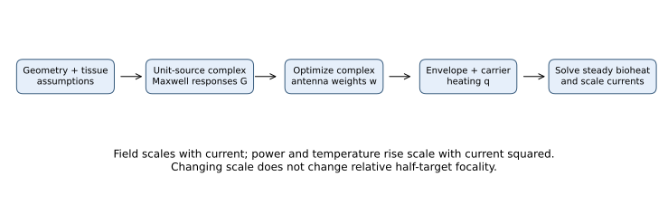
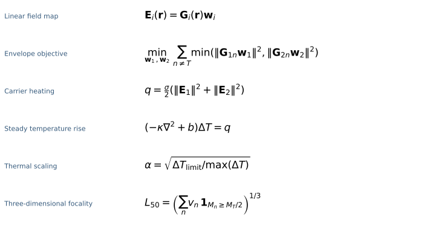
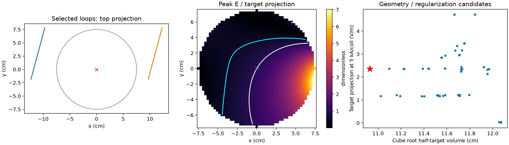
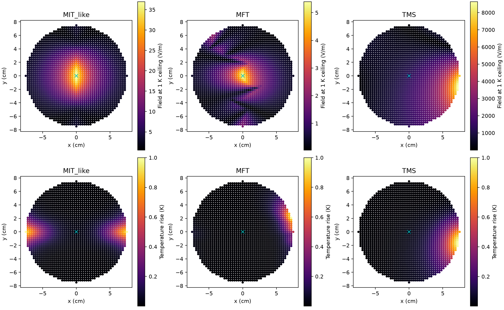

# EMvelop reproduction attempt and extended TMS comparison

Updated 2026-11-12. Public synthetic simulations only; run instructions are in [the usage guide](emvelop-usage.md).

## Scope and corrections

The initial study was a vacuum TMS feasibility test, **not an EMvelop reproduction**. This extension adds a lossy full-wave RF forward operator, per-antenna complex optimization, an extended two-coil search, and a shared steady bioheat model. It distinguishes the published results from the outputs of our simplified models. Matching one number by adjusting conductivity or source scale would not establish reproduction.

Two corrections matter:

1. The published **3D focality is cube root of volume**, not an equivalent sphere diameter. The old diameter remains a labelled diagnostic; it cannot be compared directly with 3.59 cm.
2. The EMvelop focality objective penalizes the **minimum carrier power at each location**, not the sum of carrier powers. These objectives are different. The RF implementation now optimizes the former; the TMS quadratic objective is described separately.

## Published reference and reproducibility boundary

Ahsan et al., *EMvelop stimulation: minimally invasive deep brain stimulation using temporally interfering electromagnetic waves*, JNE 19 (2022), 046005: [paper](https://doi.org/10.1088/1741-2552/ac7894), [abstract](https://pubmed.ncbi.nlm.nih.gov/35700717/). The [author's research page](https://fatimaahsan.rice.edu/projects/) reports these distinct central-target results:

| Published design | Target envelope | Cube-root half-target volume |
|---|---:|---:|
| Maximum intensity (MIT) | 11.98 V/m | 3.59 cm |
| Maximum focality (MFT) | 3.04 V/m | 2.78 cm |

The authors' [technical disclosure](https://patents.google.com/patent/US12478788B2/en), equations 8–9 and its 3D modelling section, specifies twelve line antennas per endocranial array, a 4.2 × 4.7 cm footprint, opposed placement, heterogeneous anatomical FEM, and subsequent thermal/SAR scaling. It uses norm-balanced target constraints and an off-target minimum-power objective; reported 3D scaling uses 10 W/kg averaged over 10 g. This is a description of their study criterion, not current medical advice. Its 2D analysis instead uses square-root area and a temperature-rise limit.

The original anatomy, COMSOL model, exact source implementation and original optimization outputs are **not available in this checkout**. Direct thesis and author-page downloads failed in this environment; indexed source text was accessible. Therefore the new computation is a **method-level reproduction attempt in a homogeneous surrogate**, not a verified reproduction of the 11.98/3.59 and 3.04/2.78 results. Numerical differences are retained rather than tuned away.

## Explicit forward model

We use peak phasors with time convention $e^{i\omega t}$. The general driven Maxwell problem is

$$
\nabla\times\mu^{-1}\nabla\times\mathbf E
-\left(\omega^2\epsilon-i\omega\sigma\right)\mathbf E
=-i\omega\mathbf J_s.
$$

In homogeneous infinite tissue this has a dyadic Green-function solution:

$$
k^2=\omega^2\mu\epsilon-i\omega\mu\sigma,
\qquad g(R)=\frac{e^{-ikR}}{4\pi R},\quad \operatorname{Im}k<0,
$$

$$
\mathbf E(\mathbf r)=-i\omega\mu\int
\left(\mathbf I+\frac{\nabla\nabla}{k^2}\right)
 g(|\mathbf r-\mathbf r'|)\,\mathbf J_s(\mathbf r')\,dV'.
$$

The branch makes outward waves attenuate. Finite line currents are integrated numerically; this retains propagation, attenuation and near-field terms. It is not an anatomical FEM and contains no tissue-interface reflections. Stacking unit-source fields gives

$$
\mathbf E_i(\mathbf r_n)=\mathbf G_{i,n}\mathbf w_i,
\qquad w_{im}=a_{im}e^{i\phi_{im}}.
$$

The RF method report gives the chosen dimensions, tissue assumptions, quadrature, code mapping, solver diagnostics and deviations from the original study. The two carriers are close enough that their field operators can be approximated as equal-frequency operators; their powers still add after averaging a complete beat.

For TMS the quasistatic primary field is instead

$$
\mathbf E(\mathbf r,t)=-\frac{\mu_0}{4\pi}
\sum_j\frac{dI_j}{dt}\oint_{C_j}\frac{d\boldsymbol\ell'}{|\mathbf r-\mathbf r'|}.
$$

The updated TMS study integrates arbitrary tilted/translated loops and optimizes their amplitudes and phases. It still omits conductivity-interface secondary fields. See [TMS forward model and optimization report](tms-phase-report.md).

## Envelope definition and actual optimization

For scalar or collinear carriers the envelope excursion is

$$
M_n=2\min\left(|E_{1n}|,|E_{2n}|\right).
$$

For comparison with the source methodology we also compute its orientation-free norm metric

$$
M_n^{\mathrm{norm}}=2\min\left(\|\mathbf G_{1n}\mathbf w_1\|_2,
\|\mathbf G_{2n}\mathbf w_2\|_2\right).
$$

For nonparallel vector fields this is not generally the modulation along a neuron. It must not be interpreted as a validated neural stimulus. Initial phase between distinct frequencies moves beat timing, whereas phases **within** an antenna array change spatial interference.

The original target-fit formulation alone is underdetermined: many excitation vectors can produce the requested balanced target. Our intensity baseline selects the minimum-current-norm solution at a fixed target orientation. It is not a global maximum of target intensity under a thermal constraint.

Our RF focality optimization uses the minimum-power objective with explicit vector target constraints:

$$
\min_{\mathbf w_1,\mathbf w_2}
\sum_{n\ne T}\min\left(
\|\mathbf G_{1n}\mathbf w_1\|_2^2,
\|\mathbf G_{2n}\mathbf w_2\|_2^2\right),
\qquad
\mathbf G_{iT}\mathbf w_i=\frac12\mathbf e_z.
$$

Fixing the target vector is stricter than fixing its norm. Let $\mathbf w_{i0}$ satisfy that constraint and $\mathbf N_i$ span the nullspace of $\mathbf G_{iT}$. Then

$$
\mathbf w_i=\mathbf w_{i0}+\mathbf N_i\mathbf z_i
$$

satisfies the constraint for every iterate. Optimization operates on real and imaginary parts of $\mathbf z_i$. Each active minimum branch has a quadratic derivative; ties are nonsmooth. Multiple starts reduce sensitivity but do not prove a global optimum. Solver status, objective change and target residuals are saved.

The TMS objective is a different, explicitly quadratic surrogate:

$$
\min_{\mathbf w}\ \mathbf w^H(\mathbf B_O^H\mathbf B_O+\lambda\mathbf I)\mathbf w,
\qquad \mathbf c\mathbf w=1.
$$

It penalizes off-target induction-field energy, with ridge regularization of current. For positive-definite $\mathbf Q$ its solution is

$$
\mathbf w=\frac{\mathbf Q^{-1}\mathbf c^H}
{\mathbf c\mathbf Q^{-1}\mathbf c^H}.
$$

An outer discrete geometry search evaluates these solutions; it is not an exhaustive search over all coil arrangements or direct minimization of thresholded focal volume.

## Shared thermal calculation and focality

RF carrier heating and coherent TMS burst heating are, respectively,

$$
q_{\mathrm{RF}}=\frac{\sigma_{\mathrm{RF}}}{2}
\left(\|\mathbf E_1\|^2+\|\mathbf E_2\|^2\right),
\qquad
q_{\mathrm{TMS}}=\frac{D\sigma_{\mathrm{LF}}}{2}\|\mathbf E\|^2.
$$

Here $q$ is W/m³, and local SAR is $q/\rho$. The complex-vector norm gives mean-square heating correctly even for elliptical polarization; it is not generally the instantaneous peak vector magnitude.

The new shared model solves the temperature rise above a fixed blood-temperature baseline:

$$
(-\kappa\nabla^2+b)\Delta T=q,
\quad \partial_n\Delta T=0,
\quad b=\rho_b c_b\omega_b.
$$

Assumed values are $\kappa=0.5$ W/(m K) and $b=10000$ W/(m³ K), constant in both domains. These are illustrative homogeneous parameters, not a reconstruction of Fatima's tissue table. Baseline metabolic heat cancels in the temperature-rise equation. The code uses conservative nearest-neighbour voxel fluxes, omits flux across missing boundary faces, and solves the positive-definite system by conjugate gradients. Uniform heating has the exact solution $\Delta T=q/b$, used as a test; total source equals total perfusion removal at equilibrium.

For a 1 K ceiling, post-solve current scaling is

$$
\alpha=\sqrt{\frac{1\ \mathrm K}{\max_n\Delta T_n}},
\quad \mathbf E\mapsto\alpha\mathbf E,
\quad q\mapsto\alpha^2q.
$$

This rescales a previously optimized pattern; it does not optimize the pattern jointly with thermal constraints. It also omits coil copper loss and hardware limits. A common heat model enables a controlled model comparison, not a clinical safety ranking.

For voxel volume $v$, the primary 3D metric is

$$
L_{50}=\left(v\sum_n\mathbf1[M_n\ge M_T/2]\right)^{1/3}.
$$

All disconnected off-target regions count. This is not FWHM or a connected focus diameter. Scaling current does not change it. A corresponding slice metric uses square root of area. Both waveform, duty and neural response must also be specified before any equal-focality comparison is interpreted biologically.

## Numerical results and figures

The detailed run reports and generated comparison below contain actual solver results, convergence checks and field maps. No published result is substituted for a computed value.

| Computed model, 3 mm evaluation | $L_{50}$ | Target at common 1 K ceiling | Interpretation |
|---|---:|---:|---|
| RF minimum-current baseline | 3.613 cm | 36.98 V/m envelope proxy | Same pattern family, different intensity from published MIT |
| RF local MFT solution | 2.824 cm | 5.40 V/m envelope proxy | Narrower exposure, stronger carrier heating hotspots |
| Extended two-loop TMS | 10.932 cm | 1228.98 V/m peak | Thermal-only extrapolation; hardware constraints excluded |

The RF focalities happen to approach 3.59 and 2.78 cm, but the original 3D SAR-scaled intensities are **not reproduced**: our approximate cube-averaged SAR scaling gives 37.70 and 5.73 V/m, versus published 11.98 and 3.04 V/m. Our finest averaging cube has 9.261 g when fully occupied and less at boundaries; it is not the original exact 10-g procedure. This discrepancy, the homogeneous geometry and the altered target constraints rule out a claim of quantitative reproduction.

The TMS thermal ceiling would require roughly 323 and 2607 kA in the two single-turn loops. At an illustrative 5 kA per-coil cap the optimized central field is only **2.357 V/m**. Its maximum field is about seven times the central target field. This is why the thermal-only 1229 V/m number must not be presented as feasible stimulation performance. The source strengths and waveform differ from continuous RF; neither field norm predicts equivalent neural recruitment.

The temperature maps use the same scale. The field maps have separate scales because the thermal-only amplitudes differ greatly. Heating peaks near the sources rather than at the intended RF envelope focus. The temperature result is steady state; a finite-duration protocol requires the transient heat equation.

### What the extended comparison answers

- **At the same model temperature ceiling:** the RF patterns have substantially smaller relative suprathreshold volumes. Low-duty TMS permits higher peak fields thermally, but the two-coil patterns remain broad and the required currents exceed the illustrative current cap.
- **At the same compact focality:** none of the tested two-coil configurations reaches the RF focality, so there is no computed equal-focality pair to rank by heating. This is a result about the tested geometry family, not a theorem about all TMS coil designs.
- **Compared with the original study:** the spatial trend is reconstructed; the anatomical, thermal and intensity results are not fully reproduced. An original transfer matrix or complete anatomical simulation specification is needed to resolve those differences.

## Verification and code map

| Operation | Source / generated record |
|---|---|
| RF Maxwell operator, nullspace constraints, MFT derivatives | `src/emvelop_rf.py`, [RF method report](emvelop-rf-methods.md) |
| Arbitrary loop operator and quadratic optimization | `src/tms_phase_design.py`, [TMS report](tms-phase-report.md) |
| Conservative heat solver | `src/emvelop_thermal.py` |
| Temperature comparisons and residuals | `analysis/emvelop/thermal_comparison.json` |
| RF weights, phases, objectives and grid checks | `analysis/emvelop/rf_results.json` |
| TMS geometry candidates and grid checks | `analysis/emvelop/tms_extended.json` |

The heat solves have relative residuals below $10^{-10}$ and relative integrated energy-balance errors below $10^{-11}$. Tests include exact uniform-heating equilibrium, positive localized heating and scaling, complex optimization derivatives, target constraints, source quadrature, loop symmetry and vector polarization. Fixed-current evaluation-grid checks do not establish convergence of the nonconvex optimization itself; the RF method report separately records optimization-grid sensitivity.

Math is written as Markdown LaTeX ($...$ and standalone $$ blocks), rather than code spans. The equation figure provides a rendered fallback for viewers that do not support LaTeX. Figures are generated locally by Python and included as standalone artifacts.
