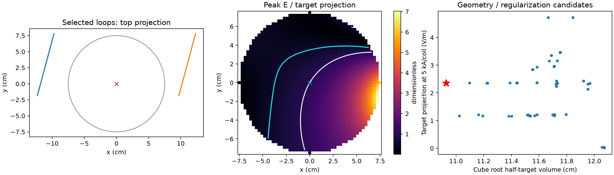

# Bilateral TMS: explicit forward model and phase/amplitude design

Updated 2026-11-12. This extension adds coil displacement and tilt, amplitude optimization, a precise complex-vector field metric, and a common 7.5 cm observation sphere for comparison with the new RF surrogate. The original 9 cm sphere / 3 cm off-axis experiment remains reproducible through `scripts/run_emvelop.py`; its numerical results should not be mixed with the central-target results here.

## Forward problem actually solved

Each coil is a circular filament, with centre $\mathbf c_j$, radius $a=0.05\,\mathrm m$, and unit normal $\mathbf n_j$. Two perpendicular unit vectors $\mathbf u_j,\mathbf v_j$ span its plane:

$$
\mathbf r_j(\theta)=\mathbf c_j+a(\mathbf u_j\cos\theta+\mathbf v_j\sin\theta),
\qquad
\mathrm d\boldsymbol\ell_j=a(-\mathbf u_j\sin\theta+\mathbf v_j\cos\theta)\,\mathrm d\theta.
$$

For a peak-current phasor $I_j$ and time convention $e^{i\omega t}$, the vacuum primary field is

$$
\mathbf A_j(\mathbf r)=\frac{\mu_0 I_j}{4\pi}
\oint\frac{\mathrm d\boldsymbol\ell_j}{\lVert\mathbf r-\mathbf r_j\rVert},
\qquad
\mathbf E_j(\mathbf r)=-i\omega\mathbf A_j(\mathbf r).
$$

The implementation integrates the filament by periodic midpoint quadrature (128 segments during search, 256 for final evaluation). It omits the common factor $-i$, which changes only the time origin. The resulting real matrix $G_p\in\mathbb R^{3\times2}$ maps peak coil currents in kA to electric field in V/m:

$$
\mathbf E_p=G_p\mathbf w,\qquad \mathbf w\in\mathbb C^2.
$$

No scalar-potential correction, tissue conductivity boundary, secondary current field or RF propagation is solved. Conductivity appears only in thermal postprocessing. The validity is limited to the stated vacuum primary-field feasibility model.

## Optimization actually solved

The target is the sphere centre, with desired electric-field projection along $\mathbf d=(0,0,1)$. Define $h=\mathbf d^T G_T$. A 1 cm ball around the target is excluded from the off-target power objective. For each candidate geometry and regularization value $\lambda\in\{0,0.01,1\}$, solve

$$
\begin{aligned}
\underset{\mathbf w\in\mathbb C^2}{\operatorname{minimize}}\quad
&\mathbf w^H Q_\lambda\mathbf w\\
\operatorname{subject\ to}\quad&h\mathbf w=1\ \mathrm{V/m},\\
Q_0&=\frac1{N_O}\sum_{p\in O}G_p^H G_p,\\
Q_\lambda&=Q_0+\lambda\frac{\operatorname{tr}(Q_0)}2 I.
\end{aligned}
$$

The ridge term penalizes current magnitude relative to the field-energy objective. This is an equality-constrained convex quadratic problem, not an iterative heuristic. Its solution is

$$
\mathbf w_\star=
\frac{Q_\lambda^{\dagger}h^H}{hQ_\lambda^{\dagger}h^H},
$$

where the pseudoinverse also handles redundant basis fields. Unreachable target orientations are rejected. The target residual is exported and tested. The solver supports complex transfer matrices; for these real vacuum bases and a real target constraint, an optimal solution is real. Thus optimal phases reduce to 0 or 180 degrees. Adding arbitrary quadrature phase would expend objective power without improving this constrained projection.

The finite geometry search evaluates centres $x=\pm11$ cm, independently selected $y\in\{-3,0,3\}$ cm, and normals tilted by $-15$, 0 or 15 degrees about z. This gives 81 pairs, each with three regularizations, before target-null rejection. All loops remain outside the 7.5 cm observation sphere. A 6 mm grid is used to select the candidate with smallest half-target volume; ties prefer the larger target field achievable with a 5 kA per-coil cap. The selected weights are held fixed for 4 and 3 mm evaluation. This searches a finite family, **not all possible two-coil geometries**, and the quadratic inner objective is a surrogate for focality rather than direct half-volume minimization.

## Field, focality and heating definitions

For a general vector phasor $\mathbf E=\mathbf a+i\mathbf b$, $\lVert\mathbf E\rVert$ is not always the instantaneous peak. The implementation uses the exact result

$$
E_{\mathrm{pk}}^2=\frac12\left[A+B+\sqrt{(A-B)^2+4C^2}\right],
\quad A=\mathbf a\cdot\mathbf a,\ B=\mathbf b\cdot\mathbf b,\ C=\mathbf a\cdot\mathbf b.
$$

This matters for future noncollinear, complex-current designs. Time-average Joule heating still depends on the complex norm:

$$
\operatorname{SAR}_p=\frac{\sigma D}{2\rho}\mathbf E_p^H\mathbf E_p,
\quad \sigma=0.2\ \mathrm{S/m},\quad \rho=1000\ \mathrm{kg/m^3},\quad D=0.002.
$$

Here $D$ is a sinusoidal-equivalent burst duty, not an exact clinical pulse waveform. The direct current/voltage constraints of a real stimulator are not part of the optimization. A 2 W/kg pointwise proxy is reported only for transparent scaling; it is not a regulatory compliance limit. Copper heating is excluded.

The primary 3D focality metric is the cube root of the *entire* volume above half the target projection:

$$
V_{1/2}=\sum_p\Delta^3\mathbf1\left[E_{\mathrm{pk},p}\ge\tfrac12\lvert h\mathbf w\rvert\right],
\qquad L_{1/2}=V_{1/2}^{1/3}.
$$

The cube-root definition matches the mathematical construction used for the reported 3D EMvelop result; anatomy and physical models remain different. The equivalent sphere diameter is a secondary diagnostic, $d_{\mathrm{eq}}=(6V_{1/2}/\pi)^{1/3}$, and must not be labeled as the paper's focality. The slice diagnostic is $\sqrt{A_{1/2}}$ at z=0. All disconnected high-field regions count; none are discarded to make a focus appear smaller.

## Executed results

The central target is marked by a cross. Cyan and white contours mark 0.5 and 1 times the target projection. The selected design is the red star in the candidate plot. A smaller threshold volume does not imply a central local maximum: the visible dominant lobe is peripheral.

| Finest 3 mm result | Value |
|---|---:|
| Coil centres | (-11,3,0), (11,3,0) cm |
| Both normal tilt angles about z | -15 degrees |
| Selected regularization | 1 |
| Peak currents for 1 V/m target projection | +0.2631, -2.1210 kA |
| Relative phase | 180 degrees |
| Target constraint residual on search grid | $2.22\times10^{-16}$ V/m |
| Half-target volume | 1306.53 cm³ |
| **Cube root half-target volume** | **10.932 cm** |
| Equivalent sphere diameter | 13.564 cm |
| Slice square root half-target area | 10.504 cm |
| Maximum peak / target projection | 7.029 |
| Target projection with both currents limited to 5 kA | 2.357 V/m |
| Currents for 100 V/m target projection | 26.31 and 212.10 kA |
| Maximum SAR per (V/m target)², duty 0.002 | $9.881\times10^{-6}$ W/kg |
| Target under 2 W/kg pointwise proxy only | 449.90 V/m |

The thermal-only scaling demands unrealistically large single-turn currents. It is neither a hardware-feasible operating point nor a safety certificate. At 100 V/m target projection, the peripheral peak would be approximately 703 V/m and the postprocessed maximum SAR approximately 0.0988 W/kg at the specified duty. The low tissue-heating number does not fix peripheral neural exposure or copper heating.

Offsets remove the axial-null obstruction of the earlier strictly coaxial model, but the best candidate remains broad and strongly superficial. This is a substantive extension of the initial feasibility test: it shows why fixing the null alone does not establish deep focality.

## Numerical verification and source mapping

| Function in `src/tms_phase_design.py` | Responsibility |
|---|---|
| `loop_nodes`, `loop_field` | Filament geometry and quadrature; V/m per kA |
| `constrained_weights` | Exact complex quadratic solution and trace-scaled ridge |
| `vector_peak` | Exact peak of vector sinusoid, including elliptical polarization |
| `search` | Geometry/ridge enumeration and threshold-volume selection |
| `metrics`, `evaluate` | Volume, area, current and SAR diagnostics; fixed-weight refinement |

Four tests passed: agreement with the prior axis-aligned loop integrator; rotational covariance; exact peak against a time sweep for elliptical polarization; and complex quadratic optimality against feasible null-space perturbations. Three-grid results are exported in `analysis/emvelop/tms_extended.json`. The cube-root volume is 10.928 cm at 6 mm and 10.932 cm at 3 mm. Sampled maxima converge more slowly than volume: the 6 mm maximum/target ratio is 6.287 versus 7.029 at 3 mm. No sub-percent hotspot convergence is claimed.

`analysis/emvelop/tms_extended_fields.npz` exports points, complex fields normalized to 1 V/m target projection, 3 mm spacing, radius, conductivity and duty for shared thermal postprocessing. That postprocessing is separate from this vacuum field solve. Run instructions are maintained in [the shared usage guide](emvelop-usage.md); executable runner: `scripts/run_tms_phase_design.py`.
